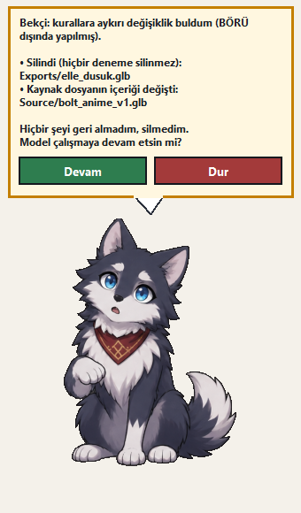

<p align="center"></p>

<h1 align="center">BÖRÜ</h1>
<p align="center"><b>A meticulous wolf that sits beside your AI model.</b><br>
It measures every step, explains it in writing, stops what breaks your rules, and asks <i>you</i> before anything permanent.</p>
<p align="center"><a href="README.tr.md">Türkçe</a> · <a href="https://github.com/anildagci/boru/releases">Download</a> · <a href="#roadmap">Roadmap</a></p>

---

BÖRÜ is a free, open-source helper for people who work with AI coding assistants such as **Claude Code** and **Codex**.
It connects to them over [MCP](https://modelcontextprotocol.io) and lives on your desktop as a small wolf.

Its first specialist pack drives your installed **Blender** along the path *from a drawing to a game-ready 3D character*:
inspect a model, find the eyes, fit a generated head onto a body, merge into one model with one texture, export, verify,
deliver. The long-term goal is broader: a general **AI-usage assistant** that carries a proven working method
(clarify first, measure don't guess, never destroy work, ask before permanent actions) and, step by step, its own small
language model trained on what it learns.

| The model wants to deliver | The watchdog caught a change | First launch |
|---|---|---|
|  |  |  |

## Why

AI models are fast and creative, and sometimes confidently wrong. BÖRÜ is the strict partner next to them:

- **Measures instead of guessing.** Every tool answers with numbered findings (triangle counts, parts, textures,
  alignment), lists what it did *not* touch, and returns images the model can look at.
- **Watchdog.** Before every call it compares the working folder with its last snapshot. Changed source files, deleted
  attempts, overwritten deliveries, dropped triangle counts or shrunk textures are reported; rule-breaking changes stop
  the work until you say *Continue*.
- **You approve, not the model.** Deliveries, rule changes and decisions are asked in BÖRÜ's own window. The answer
  comes only from your click.
- **Learns, carefully.** It keeps a local log and turns recurring situations into *lesson candidates* with evidence.
  Nothing changes BÖRÜ's behaviour on its own; approved lessons go into the next version.
- **Your mascot.** Pick the wolf, or create your own mascot in three steps (describe → generate → choose image).
- **Turkish and English.**

## Install

1. Download `BORU_Kurulum_<version>.exe` from [Releases](https://github.com/anildagci/boru/releases) and run it.
   No administrator rights needed. The installer is not code-signed yet, so Windows may say *Unknown publisher*:
   click *More info → Run anyway*.
2. Install [Blender 5](https://www.blender.org) for the 3D pack (BÖRÜ finds it on its own).
3. Open BÖRÜ. If Claude Code or Codex is installed and not connected, the wolf offers to connect
   (it backs up the settings file and writes only the `boru` entry). Restart that app.
4. In Claude Code or Codex, ask for example: *"Using BÖRÜ, inspect this model and fit the head onto the body."*

<details><summary>Manual connection</summary>

**Claude Code** — `.mcp.json` in your project (or `~/.claude.json` → `mcpServers`):
```json
{ "mcpServers": { "boru": { "type": "stdio", "command": "C:\\Users\\<you>\\AppData\\Local\\Programs\\BORU\\BORU.exe", "args": ["--mcp"] } } }
```
**Codex** — `~/.codex/config.toml`:
```toml
[mcp_servers.boru]
command = 'C:\Users\<you>\AppData\Local\Programs\BORU\BORU.exe'
args = ["--mcp"]
tool_timeout_sec = 900
```
Long 3D steps take minutes at full resolution; keep the tool timeout generous.
</details>

## Tools (MCP)

| Tool | What it does |
|---|---|
| `boru_basla` | Start: working folder + mode (`arac`: only BÖRÜ's tools, or `hibrit`: your own Blender scripts too) |
| `boru_durum` | Folder state: attempts, delivery, mode |
| `boru_incele` | Look at a GLB without touching it: triangles, parts, textures, 8-angle colour and clay renders |
| `boru_gozler` | Render the face from the front and find both eyes (alignment anchor) |
| `boru_oturt` | Fit a single-part head onto a body, aligned by the eyes; red/green check renders |
| `boru_birlestir` | One model, one texture; export; reopen and verify |
| `boru_teslim` | Deliver (backs up the previous one) — **asks you in the window** |
| `boru_kontrol` | Measure any .blend/.glb and render front/back |
| `boru_denetle` | Watchdog check; measures new models against the reference |
| `boru_not` / `boru_dersler` | Experience notes; lesson candidates with evidence |

### Working-with-AI assistant (any task, no folder needed)

| Tool | What it does |
|---|---|
| `boru_yontem` | Brings the working rules that fit your situation (when / do / don't / why). Empty question → catalogue |
| `boru_risk` | Give it a plan before a long job; it lists what to clarify first (deletion, overwrite, money, publishing, guessing, wide scope, no tests, no approval gate) |
| `boru_liste` | Checklists: project start, pre-delivery quality, briefing a helper agent, visual review |
| `boru_profil` | Reads *your* private working profile from `Documents\BORU\ozel\PROFIL.md`, if you write one. It never leaves your computer |

The rules live in [`bilgi/kurallar.json`](bilgi/kurallar.json) and are readable as
[a method guide](bilgi/YONTEM.en.md) ([Türkçe](bilgi/YONTEM.tr.md)). 25 rules, distilled from real AI-assisted projects
(game development, 3D characters, social video production, this tool). [`bilgi/ornekler.jsonl`](bilgi/ornekler.jsonl) is
the same knowledge as chat-format training examples for the small model planned in phases 5–6.

## Privacy

Everything stays on your computer: settings, log, lessons and your own mascots live in `Documents\BORU`.
**By default BÖRÜ sends nothing.** On first launch it asks once whether you want to send an *anonymous* weekly usage
summary (counts and lesson candidates; no file, folder or person names, no notes, no images). Everything it would send is
first written to `Documents\BORU\gonderilenler` so you can see it; you can turn it off any time. Details:
[PRIVACY.md](PRIVACY.md).

## Honest limits

- BÖRÜ is a rule-based tool, not an AI model (yet — see the roadmap). The assistant tools match keywords; they don't understand.
- The head-to-body fit is tested on two collar types (t-shirt neckline, high jacket collar) and two characters.
- Eye detection thresholds were measured on four images; a face covered by hair may fail (BÖRÜ says so).
- Windows only for now. Unsigned installer.

## Build from source

Python 3.11+ with `pyinstaller numpy opencv-python pillow`, then `derle.bat` (→ `dist\BORU.exe`) and
`kurulum\kurulum_derle.bat` (Inno Setup 6, → `kurulum\cikti\`). Run from source: `python boru.py` (window) or
`python boru.py --mcp` (MCP server). GitHub Actions builds both on every tag.

## Roadmap

1. ✅ Publish: two languages, installer, this repo.
2. ✅ Opt-in anonymous feedback (consent, see-what-is-sent, off by default).
3. ✅ Knowledge: a written working method distilled from real AI-assisted projects.
4. ✅ Assistant tools: project start checklist, quality control, "let's clarify this first", alternatives.
5. A small local model (downloaded only with consent, runs on your GPU only when needed).
6. Fine-tuning loop: curated, anonymous lessons → dataset → better small model, every release.

## License

GPL-3.0 (see [LICENSE](LICENSE)); the Blender scripts must stay GPL-compatible. © 2026 DownStroke Studios.
