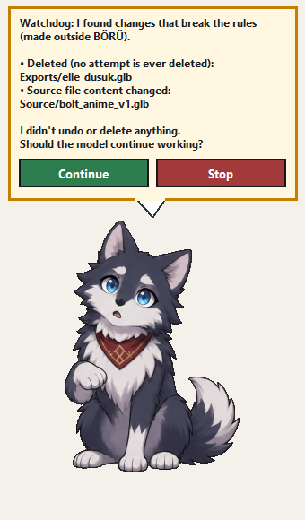
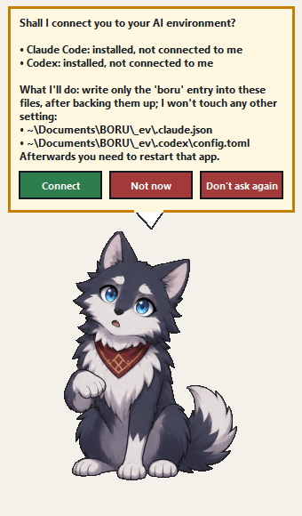

<p align="center"></p>

<h1 align="center">BÖRÜ</h1>
<p align="center"><b>The wolf that guards your work while you work with AI.</b><br>
The goal: before an AI deletes something, it asks you in plain words; if it was deleted, it brings it back.</p>
<p align="center"><a href="README.tr.md">Türkçe</a> · <a href="https://github.com/anildagci/boru/releases">Download</a> · <a href="#roadmap">Roadmap</a></p>

---

BÖRÜ is a free, open-source helper for people who build projects with AI assistants such as **Claude** and **Codex**
without knowing how to code. It lives on your desktop as a small wolf and connects to the assistant over
[MCP](https://modelcontextprotocol.io).

AI is fast, and sometimes confidently wrong: it deletes the wrong folder, overwrites two weeks of work, says "it works"
when it doesn't. A programmer notices; someone who doesn't code often notices when it's too late. BÖRÜ is built for that
moment: it explains what is about to happen without jargon, leaves permanent decisions to you, and takes a backup first
so your work isn't lost.

> **Where it stands today (0.6.2):** the watchdog only watches the 3D pack's folders, and changes made outside BÖRÜ are
> detected **afterwards**, not prevented. Stopping actions before they happen, working in any folder, and undo are the
> work of the next 90 days. Details: [Honest limits](#honest-limits).

| The model wants to deliver | The watchdog caught a change | First launch |
|---|---|---|
|  |  |  |

## What it does today

- **Watchdog.** Before every BÖRÜ tool call it compares the working folder with its last snapshot. Changed source files,
  deleted attempts, overwritten deliveries, dropped triangle counts or shrunk textures are reported; rule-breaking changes
  stop the work until you say *Continue*.
- **You approve, not the model.** Deliveries, rule changes and decisions are asked in BÖRÜ's own window. The answer
  comes only from your click; the AI cannot give this approval itself.
- **A working method.** For any task (not just 3D), no folder needed: `boru_yontem` brings the working rules that fit
  your situation, `boru_risk` scans a plan before a long job and lists what to clarify first, `boru_liste` gives
  checklists, `boru_profil` reads your private working profile. 25 rules distilled from real AI-assisted projects:
  [method guide](bilgi/YONTEM.en.md) ([Türkçe](bilgi/YONTEM.tr.md)).
- **First specialist pack: 3D characters.** Drives your installed **Blender** *from a drawing to a game-ready 3D
  character*: inspect, find the eyes, fit a generated head onto a body, merge into one model with one texture, export,
  verify, deliver. Every step answers with numbered findings and lists what it did *not* touch.
- **Learns, carefully.** It keeps a local log and turns recurring situations into *lesson candidates* with evidence.
  Nothing changes BÖRÜ's behaviour on its own; approved lessons go into the next version.
- **Your mascot.** Pick the wolf, or create your own mascot in three steps (describe → generate → choose image).
- **Turkish and English.**

## Install

1. Download `BORU_Kurulum_<version>.exe` from [Releases](https://github.com/anildagci/boru/releases) and run it.
   No administrator rights needed. The installer is not code-signed yet, so Windows may say *Unknown publisher*:
   click *More info → Run anyway*. (A signed installer is in the 90-day plan.)
2. Install [Blender 5](https://www.blender.org) for the 3D pack (BÖRÜ finds it on its own). Not needed for the method tools.
3. Open BÖRÜ. If Claude Code or Codex is installed and not connected, the wolf offers to connect
   (it backs up the settings file and writes only the `boru` entry). Restart that app.
4. In Claude Code or Codex, ask for example: *"Using BÖRÜ, scan my plan for risks before we start."*

<details><summary>Manual connection</summary>

**Claude Code** — `.mcp.json` in your project (or `~/.claude.json` → `mcpServers`):
```json
{ "mcpServers": { "boru": { "type": "stdio", "command": "C:\\Users\\<you>\\AppData\\Local\\Programs\\BORU\\BORU.exe", "args": ["--mcp"] } } }
```
**Codex** — `~/.codex/config.toml`:
```toml
[mcp_servers.boru]
command = 'C:\Users\<you>\AppData\Local\Programs\BORU\BORU.exe'
args = ["--mcp"]
tool_timeout_sec = 900
```
Long 3D steps take minutes at full resolution; keep the tool timeout generous.
</details>

## Tools (MCP)

### Working with AI (any task, no folder needed)

| Tool | What it does |
|---|---|
| `boru_yontem` | Brings the working rules that fit your situation (when / do / don't / why). Empty question → catalogue |
| `boru_risk` | Give it a plan before a long job; it lists what to clarify first (deletion, overwrite, money, publishing, guessing, wide scope, no tests, no approval gate) |
| `boru_liste` | Checklists: project start, pre-delivery quality, briefing a helper agent, visual review |
| `boru_profil` | Reads *your* private working profile from `Documents\BORU\ozel\PROFIL.md`, if you write one. It never leaves your computer |
| `boru_sor` / `boru_model` | Experimental local model (see below): ask a method question / model status |

### 3D pack

| Tool | What it does |
|---|---|
| `boru_basla` | Start: working folder + mode (`arac`: only BÖRÜ's tools, or `hibrit`: your own Blender scripts too) |
| `boru_durum` | Folder state: attempts, delivery, mode |
| `boru_incele` | Look at a GLB without touching it: triangles, parts, textures, 8-angle colour and clay renders |
| `boru_gozler` | Render the face from the front and find both eyes (alignment anchor) |
| `boru_oturt` | Fit a single-part head onto a body, aligned by the eyes; red/green check renders |
| `boru_birlestir` | One model, one texture; export; reopen and verify |
| `boru_teslim` | Deliver (backs up the previous one) — **asks you in the window** |
| `boru_kontrol` | Measure any .blend/.glb and render front/back |
| `boru_denetle` | Watchdog check; measures new models against the reference |
| `boru_not` / `boru_dersler` | Experience notes; lesson candidates with evidence |

## Experimental: local small model (frozen)

BÖRÜ can run a small model (Qwen3 4B) on your own graphics card through [Ollama](https://ollama.com). Off by default;
downloaded only after you click **Yes**; everything stays on your computer (right-click the wolf > **Local model…** /
**Ask BÖRÜ…**). It keeps working as it is but is **no longer developed**: the attempt to fine-tune our own model did not
reach its target (see [`egitim/SONUCLAR.md`](egitim/SONUCLAR.md), in Turkish), and users already have Claude or Codex.
BÖRÜ's value is in the watchdog and the method, not in a model. The rules are also published as a dataset on Hugging
Face: [downstroke/boru-yontem](https://huggingface.co/datasets/downstroke/boru-yontem).

## Privacy

Everything stays on your computer: settings, log, lessons and your own mascots live in `Documents\BORU`.
**By default BÖRÜ sends nothing.** On first launch it asks once whether you want to send an *anonymous* weekly usage
summary (counts and lesson candidates; no file, folder or person names, no notes, no images). Everything it would send is
first written to `Documents\BORU\gonderilenler` so you can see it; you can turn it off any time. Details:
[PRIVACY.md](PRIVACY.md).

## Honest limits

- **What the watchdog covers today:** only the 3D pack's working folders (`Source`, `Blender`, `Exports`, `Textures`,
  `Backups`), checked **before each BÖRÜ tool call** and when `boru_denetle` is called. Changes made outside BÖRÜ (e.g.
  the AI's own scripts or commands) are detected **afterwards**, not prevented, and cannot be undone by BÖRÜ yet. It is
  not general file protection for any project yet. Approval for BÖRÜ's own permanent steps (delivery, rule changes) is
  enforced.
- Without the optional local model, the method tools match keywords; they don't understand.
- The head-to-body fit is tested on two collar types (t-shirt neckline, high jacket collar) and two characters. Eye
  detection thresholds were measured on four images; a face covered by hair may fail (BÖRÜ says so).
- Windows only for now. Unsigned installer.

## Build from source

Python 3.11+ with `pyinstaller numpy opencv-python pillow`, then `derle.bat` (→ `dist\BORU.exe`) and
`kurulum\kurulum_derle.bat` (Inno Setup 6, → `kurulum\cikti\`). Run from source: `python boru.py` (window) or
`python boru.py --mcp` (MCP server). GitHub Actions builds both on every tag.

## Roadmap

**Done (0.4 - 0.6.2):** two-language release and installer; opt-in anonymous feedback; a 25-rule working method and
assistant tools; an optional local model; `boru-4b` fine-tuning (measured, missed the 80% gate, not released; a better
rule search shipped instead: the right rule is in the top 4 for 93% of test questions, was 82%).

### Next 90 days (Nov 2026 - Feb 2027): a watchdog for people who don't code

Change of direction: local model development has stopped; the watchdog is now BÖRÜ's core. The audience is people who
build projects with AI without knowing how to code. These 90 days are shared with one of the studio's game projects, so
the scope is deliberately narrow.

**Month 1: verify and lay the foundation**
- **Where can we stop actions?** People who don't code mostly use AI in desktop apps. Ways to step in before an action
  (hooks) are tested one by one in Claude Code (terminal and desktop), the Claude desktop app / Cowork and Codex; the
  result is published as a table. The hook adapter is chosen from that.
- **Watchdog in any folder:** any project folder the user picks, not just the 3D folders.
- **Backup first, then undo:** before a risky action BÖRÜ backs up the files that will change; one click on *Bring it
  back* in its window. Everyone clicks *Yes* on approval prompts; being able to undo is the real safety net.

**Month 2: stop it before it happens**
- **Pre-action guarding:** deleting, overwriting, touching protected files, pushing to the main branch are caught before
  they happen and asked in BÖRÜ's window. Claude Code first, then the others whose hook support is verified.
- **Plain language:** every question without jargon: *"Claude wants to delete 14 files in the 'Chapter 3' folder. I've
  backed them up. Do you allow it?"*
- **AI damage playground:** a safe test folder with 30+ scripted scenarios. Results published, misses included.

**Month 3: real use and trust**
- **Signed installer** (free signing for open-source projects, e.g. SignPath Foundation), checksums, clean uninstall.
  Someone who doesn't code won't install past an "Unknown publisher" warning, so this is not optional.
- **Real use:** the maintainer uses it daily, then 5-10 invited people who don't code. The measure: do they still open
  it in the second week.
- **Documented boundaries:** what is prevented, what is only detected afterwards, what is out of scope.

### Not in these 90 days

- Local model work (bundled llama.cpp, own tiny models, a smaller model family, a data loop). The existing feature stays
  as it is and may be removed later.
- A paid product. Real, repeated use first; money after that.
- New specialist packs and a pack ecosystem. The 3D pack stays as the first pack; a pack format comes after the
  watchdog is solid.

### Getting BÖRÜ to people

- **One sentence:** "The wolf that asks you before AI deletes your files." The app, the installer and the README say the
  same thing.
- **One 45-second video:** the wolf stopping a real delete. When it's ready, not before.
- **"I made an AI make 30 mistakes; how many did the wolf catch?"**: the playground results, misses included.
- **The failed-model story:** "I fine-tuned my own model on one GPU; it didn't work; here's what I learned"
  ([`egitim/SONUCLAR.md`](egitim/SONUCLAR.md)), for developer communities.
- **The 25 rules:** a short post series, Turkish and English.
- Turkish first: Turkish-speaking communities of people doing real work with AI without coding. MCP directory listings
  are secondary.

## Follow DownStroke Studios

Follow the studio behind BÖRÜ for project updates and development videos:

- [Instagram](https://www.instagram.com/downstrokestudios/)
- [YouTube](https://www.youtube.com/@downstrokestudios)
- [TikTok](https://www.tiktok.com/@downstrokestudios)

## License

GPL-3.0 (see [LICENSE](LICENSE)); the Blender scripts must stay GPL-compatible. © 2026 DownStroke Studios.
