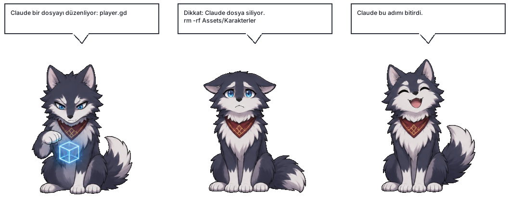

<h1 align="center">BÖRÜ</h1>

<b>Yapay zekâyla oyun yaparken masaüstünde seni ve projeni kollayan kurt.</b> 
Claude çalışırken onu izler, tepki verir; projeni silmeye kalkarsa seni uyarır.

<a href="README.md">English</a> · <a href="https://github.com/anildagci/boru/releases">İndir</a> · <a href="#yol-haritası">Yol haritası</a> · <a href="#downstroke-studios">DownStroke Studios</a>

---

BÖRÜ, **Claude Code** ya da **Codex** gibi yapay zekâ asistanlarıyla oyun (ve başka projeler) geliştirenler için ücretsiz ve
açık kaynaklı bir masaüstü yoldaşı. Ekranının köşesinde küçük bir kurt olarak durur:

- **Canlı kurt.** Claude dosya düzenlerken o da çalışır, riskli bir komutta kulaklarını dikip seni uyarır, iş bitince sevinir.
- **Bekçi.** Yapay zekâ emin bir şekilde yanılabilir: yanlış klasörü siler, haftalarca uğraştığın sahnenin üstüne yazar.
  BÖRÜ bu anlar için var. Kalıcı kararları sana bırakır.
- **Yöntem.** Gerçek projelerden çıkmış 25 çalışma kuralı ve kontrol listeleriyle yapay zekâyla daha az emek kaybedersin.
- **3B paketi.** Çizimden oyuna hazır 3B karaktere giden yolu kurulu Blender'ınla yürütür.

> **Bugünkü durum:** Canlı kurt yeni; şimdilik **yalnız izler ve uyarır, hiçbir işlemi durdurmaz**. Bekçi yalnız 3B
> paketinin klasörlerine bakıyor ve dışarıda yapılan değişikliği sonradan fark ediyor. İşlemden önce durdurma ve tek
> tıkla geri alma önümüzdeki 90 günün işi. Ayrıntı: [Dürüst sınırlar](#dürüst-sınırlar).

## Ne yapıyor

### Canlı kurt (yeni, Claude Code)
Kurda sağ tıkla > **Canlı kurt (Claude Code)…** > **Aç**. Claude Code'u (terminalde ya da Claude masaüstündeki *Code*
sekmesinde) yeniden başlat. Artık:

| Claude ne yapıyor | Kurt ne yapıyor |
|---|---|
| Bir istekle işe koyuldu | Çalışmaya başlar: "Ben de izliyorum." |
| Dosya düzenliyor ya da yazıyor | Çalışır, dosyanın adını söyler |
| Riskli bir komut çalıştırıyor (silme, `git reset --hard`, zorla gönderme…) | Endişelenir: "Dikkat: Claude dosya siliyor." |
| Senden bir şey bekliyor | Seni çağırır |
| Bu adımı bitirdi | Sevinir |

Haberler yalnız bu bilgisayarda kalır (`127.0.0.1`); BÖRÜ kapalıysa Claude Code işine normal devam eder. BÖRÜ, Claude
Code'un ayar dosyasına (`~/.claude/settings.json`) yalnız kendi girdilerini ekler ve önce yedek alır; aynı menüden kapatınca
yalnız onları siler.

### Bekçi ve onay
Her BÖRÜ aracı çağrısından önce çalışma klasörünü son anıyla karşılaştırır. Değişen kaynak, silinen deneme, üstüne
yazılan teslim, düşen üçgen ya da küçülen doku söylenir; kurala aykırı değişiklikte sen *Devam* diyene kadar iş durur.
Teslim ve kural değişikliği gibi kalıcı işler BÖRÜ'nün kendi penceresinde sorulur; yanıt yalnız senin tıklamanla gelir.

### Yapay zekâ ile çalışma yöntemi (her işte)
`boru_yontem` duruma uyan çalışma kurallarını getirir, `boru_risk` uzun bir işten önce planı tarayıp "önce şunu
netleştirmemiz lazım" listesini çıkarır, `boru_liste` proje başlangıcı, teslim öncesi kalite, yardımcı ajana iş verme ve
görsel inceleme listelerini verir, `boru_profil` yalnız senin bilgisayarında duran özel çalışma profilini okur.
Kurallar: [yöntem rehberi](bilgi/YONTEM.tr.md) (25 kural).

### 3B paketi: çizimden oyuna hazır karaktere
Kurulu **Blender**'ınla: modeli incele, gözleri bul, üretilmiş başı gövdeye oturt, tek model ve tek dokuda topla, dışa
aktar, doğrula, teslim et. Her adım numaralı bulgularla (üçgen, parça, doku, hizalama) yanıt verir ve neye
*dokunmadığını* söyler.

### Senin maskotun
Kurdu seç ya da üç adımda kendi maskotunu oluştur (anlat → üret → görseli seç). Kendi kurdunu, kedini, ejderhanı
yaptıysan paylaş; en güzellerini burada gösterelim.

## Kurulum

1. [Releases](https://github.com/anildagci/boru/releases) sayfasından `BORU_Kurulum_<sürüm>.exe`'yi indir ve çalıştır.
   Yönetici izni gerekmez. Yükleyici henüz imzalı değil; Windows *Bilinmeyen yayımcı* diyebilir:
   *Ek bilgi → Yine de çalıştır*. (İmzalı yükleyici 90 günlük planda.)
2. BÖRÜ'yü aç. Claude Code ya da Codex kurulu ve bağlı değilse kurt bağlanmayı teklif eder (ayar dosyasını yedekler,
   yalnız `boru` girdisini yazar). O uygulamayı yeniden başlat.
3. İstersen sağ tık > **Canlı kurt (Claude Code)…** ile canlı kurdu aç.
4. 3B paketi için [Blender 5](https://www.blender.org) kur (BÖRÜ yolunu kendisi bulur).

Canlı kurt şu an kaynak kodda; bir sonraki sürümle (0.7) yükleyiciye girecek. Elle bağlantı, araçların tam listesi ve
kaynaktan derleme için [README.md](README.md) (İngilizce) bölümlerine bak; ayarlar aynı.

## Deneysel: yerel küçük model (donduruldu)

BÖRÜ, [Ollama](https://ollama.com) ile senin ekran kartında küçük bir model (Qwen3 4B) çalıştırabilir. Varsayılan kapalı;
yalnız sen **Evet** dersen indirilir. Olduğu gibi çalışıyor ama **artık geliştirilmiyor**: kendi modelimizi eğitme
denemesi hedefe ulaşmadı ([`egitim/SONUCLAR.md`](egitim/SONUCLAR.md)) ve kullanıcının elinde zaten Claude ya da Codex var.

## Gizlilik

Her şey bilgisayarında kalır: ayarlar, günlük, canlı kurt günlüğü (`kanca_gunlugu.jsonl`), dersler ve kendi maskotların
`Belgeler\BORU` altında durur. **BÖRÜ varsayılan olarak hiçbir şey göndermez.** İlk açılışta bir kez, haftalık *anonim* bir
kullanım özeti göndermek isteyip istemediğini sorar; göndereceği her şeyi önce `Belgeler\BORU\gonderilenler` altına yazar.
Ayrıntı: [PRIVACY.md](PRIVACY.md).

## Dürüst sınırlar

- **Canlı kurt yalnız izler.** Riskli komutu fark edip uyarır ama durdurmaz. Riskli komut tanıma bir kalıp listesidir;
  bir betik dosyasıyla yapılan silmeyi ya da bir dosyanın içini boşaltmayı fark etmeyebilir. Şimdilik yalnız Claude Code;
  Claude masaüstü sohbeti ve Cowork'te kanca desteği yok (bkz. [kanca araştırması](docs/KANCA_ARASTIRMASI.md)).
- **Bekçinin bugünkü kapsamı:** yalnız 3B paketinin çalışma klasörleri (`Source`, `Blender`, `Exports`, `Textures`,
  `Backups`); BÖRÜ dışında yapılan değişiklikleri **sonradan** fark eder, önlemez ve henüz geri getiremez.
- Başı gövdeye oturtma iki yaka tipinde ve iki karakterde sınandı; göz bulma dört görüntüde ölçüldü.
- Şimdilik yalnız Windows. Yükleyici imzasız.

## Yol haritası

**Tamamlananlar (0.4 - 0.6.2):** iki dilli yayın ve yükleyici; isteğe bağlı anonim geri bildirim; 25 kurallık çalışma
yöntemi ve asistan araçları; isteğe bağlı yerel model; `boru-4b` ince ayarı (ölçüldü, %80 kapısına ulaşmadı, yayınlanmadı);
kanca araştırması ([sonuçlar](docs/KANCA_ARASTIRMASI.md)).

### Önümüzdeki 90 gün (Kasım 2026 - Şubat 2027): yapay zekâyla oyun yapanların kurdu

Hedef kitle: Claude Code ya da Codex'le oyun geliştiren bağımsız geliştiriciler ve sanatçılar (Godot, Unity, Blender).
Yerel model geliştirmesi durduruldu. Bu 90 gün stüdyonun bir oyun projesiyle paylaşılıyor; kapsam bilerek dar.

**1. ay: kurt canlansın**
- ✅ Canlı kurt, ilk sürüm (yalnız izler, Claude Code). Kaynak kodda; 0.7 ile yükleyiciye girer.
- Windows'ta gerçek sınama: Claude masaüstü *Code* sekmesi, terminal, uzun bekleme, BÖRÜ kapalıyken davranış.
- Kurtta daha çok tepki: uzun süre iş yokken uyuma, art arda başarılı adımlarda sevinç, uzun işlerde sabırsızlık.
- 0.7 sürümü ve ilk kısa video: "Claude çalışırken kurdum onu izliyor."

**2. ay: kurt korusun**
- **Önce yedek, sonra geri al:** riskli bir işlemden önce değişecek dosyaların yedeği; kurtta tek tıkla *Geri getir*.
  Kalıp listesinin kaçırdığı silmeye karşı asıl güvence bu.
- **İşlemden önce sor:** silme, üstüne yazma, ana dala gönderme gibi işlemlerde kurt sorar, sen *Evet* demeden olmaz.
- **Oyun projesi kuralları:** `Assets`, sahne dosyaları (`.tscn`, `.unity`, `.blend`), kayıt dosyaları, sürüm kontrolü.
- **Codex için canlı kurt** (Codex yalnız engellemeye izin veriyor; soruyu kurt sorar).
- **Yapay zekâ hata deneme alanı:** örnek bir oyun projesinde 30+ "yapay zekâ hatası" senaryosu; kurt kaçını yakaladı,
  kaçırdıkları dahil yayınlanır.

**3. ay: insanlara ulaşsın**
- **İmzalı yükleyici** (ör. SignPath Foundation), sağlama toplamları, temiz kaldırma.
- **Gerçek kullanım:** geliştirici her gün kullanır, sonra 5-10 davetli oyun geliştirici. Ölçü: ikinci hafta da açıyorlar mı.
- **Topluluk:** katkı rehberi, "ilk iş" etiketli kolay görevler, maskot ve kural katkıları.

### Bu 90 günde yapılmayacaklar
- Yerel model geliştirmesi. Mevcut özellik olduğu gibi kalır.
- Ücretli ürün. BÖRÜ ücretsiz ve açık kaynak kalır.
- Yeni uzmanlık paketleri. 3B paketi ilk paket olarak kalır.

### BÖRÜ'yü insanlara ulaştırmak
- **Tek cümle:** "Yapay zekâyla oyun yaparken masaüstünde seni ve projeni kollayan kurt."
- **Kısa videolar:** "Claude çalışırken kurdum onu izliyor", "Yapay zekâ oyun projemi silmeye kalktı, kurt uyardı",
  "Yapay zekâya oyun projemde 30 hata yaptırdım", "Tek ekran kartıyla kendi modelimi eğittim, olmadı".
- **Herkese açık geliştirme:** her BÖRÜ sürümü bir devlog bölümü; oyun devlog'larıyla aynı kanallarda.
- **Kullanıcıların maskotları:** kendi maskotunu yapanların paylaşımları.
- **Önce Türkçe:** Türk oyun geliştirici toplulukları; sonra r/godot, r/gamedev, r/ClaudeAI, r/blender.

## DownStroke Studios

BÖRÜ, bağımsız oyun ve uygulama stüdyosu **DownStroke Studios**'un maskotu ve ilk açık kaynak projesi. Kurt
devlog'larımızda, oyunlarımızda ve ileride çok daha fazlasında karşına çıkacak. Oyunlarımızı ve geliştirme sürecimizi takip
etmek, BÖRÜ'ye katkı vermek ya da ileride stüdyoyla birlikte bir şeyler yapmak istersen:

- [Instagram](https://www.instagram.com/downstrokestudios/)
- [YouTube](https://www.youtube.com/@downstrokestudios)
- [TikTok](https://www.tiktok.com/@downstrokestudios)

## Lisans

GPL-3.0 ([LICENSE](LICENSE)); Blender betikleri GPL ile uyumlu kalmalıdır. © 2026 DownStroke Studios.
