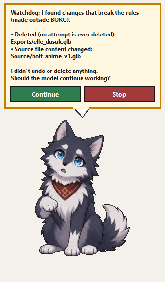
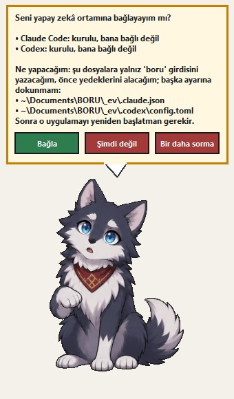

<h1 align="center">BÖRÜ</h1>

<b>Yapay zekâ modelinin yanında duran detaycı bir kurt.</b> 
Her adımı ölçer, yazıyla anlatır, kurallarına aykırı olanı durdurur ve kalıcı işlerden önce <i>sana</i> sorar.

<a href="README.md">English</a> · <a href="https://github.com/anildagci/boru/releases">İndir</a> · <a href="#yol-haritası">Yol haritası</a>

---

BÖRÜ, **Claude Code** ve **Codex** gibi yapay zekâ asistanlarıyla çalışanlar için ücretsiz ve açık kaynaklı bir
yardımcıdır. Onlara [MCP](https://modelcontextprotocol.io) ile bağlanır, masaüstünde küçük bir kurt olarak durur.

İlk uzmanlık paketi, kurulu **Blender**'ını kullanarak *çizimden oyuna hazır 3B karaktere* giden yolu yürütür: modeli
incele, gözleri bul, üretilmiş başı gövdeye oturt, tek model ve tek dokuda topla, dışa aktar, doğrula, teslim et.
Uzun vadeli hedef daha geniş: denenmiş bir çalışma yöntemini taşıyan (önce netleştir, tahmin etme ölç, emeği asla yok
etme, kalıcı işten önce sor) genel bir **yapay zekâ kullanım asistanı**; adım adım da öğrendikleriyle eğitilen kendi
küçük dil modeli.

| Model teslim etmek istiyor | Bekçi bir değişiklik yakaladı | İlk açılış |
|---|---|---|
|  |  |  |

## Neden

Yapay zekâ modelleri hızlı ve yaratıcı; bazen de emin bir şekilde yanılır. BÖRÜ onların yanındaki katı ortaktır:

- **Tahmin etmez, ölçer.** Her araç numaralı bulgularla (üçgen, parça, doku, hizalama) yanıt verir, neye
  *dokunmadığını* söyler, modelin bakabileceği görseller döner.
- **Bekçi.** Her çağrıdan önce klasörü son anıyla karşılaştırır. Değişen kaynak, silinen deneme, üstüne yazılan teslim,
  düşen üçgen ya da küçülen doku söylenir; kurala aykırı değişiklikte sen *Devam* diyene kadar iş durur.
- **Modeli değil seni dinler.** Teslim, kural değişikliği ve kararlar BÖRÜ'nün kendi penceresinde sorulur; yanıt
  yalnız senin tıklamanla gelir.
- **Dikkatle öğrenir.** Yerel bir günlük tutar, tekrar eden durumları kanıtlı *ders adaylarına* çevirir. Hiçbiri
  BÖRÜ'yü kendiliğinden değiştirmez; onaylananlar bir sonraki sürüme girer.
- **Senin maskotun.** Kurdu seç ya da üç adımda kendi maskotunu oluştur (anlat → üret → görseli seç).
- **Türkçe ve İngilizce.**

## Kurulum

1. [Releases](https://github.com/anildagci/boru/releases) sayfasından `BORU_Kurulum_<sürüm>.exe`'yi indir ve çalıştır.
   Yönetici izni gerekmez. Yükleyici henüz imzalı değil; Windows *Bilinmeyen yayımcı* diyebilir:
   *Ek bilgi → Yine de çalıştır*.
2. 3B paketi için [Blender 5](https://www.blender.org) kur (BÖRÜ yolunu kendisi bulur).
3. BÖRÜ'yü aç. Claude Code ya da Codex kurulu ve bağlı değilse kurt bağlanmayı teklif eder (ayar dosyasını yedekler,
   yalnız `boru` girdisini yazar). O uygulamayı yeniden başlat.
4. Claude Code ya da Codex'te örneğin şunu iste: *"BÖRÜ'yü kullanarak bu modeli incele ve başı gövdeye oturt."*

## Yapay zekâ ile çalışma yardımcısı

Her işte (yalnız 3B değil) ve klasör gerekmeden: `boru_yontem` duruma uyan çalışma kurallarını getirir, `boru_risk` uzun
bir işten önce planı tarayıp "önce şunu netleştirmemiz lazım" listesini çıkarır, `boru_liste` proje başlangıcı, teslim
öncesi kalite, yardımcı ajana iş verme ve görsel inceleme listelerini verir, `boru_profil` yalnız senin bilgisayarında
duran özel çalışma profilini (`Belgeler\BORU\ozel\PROFIL.md`) okur. Kurallar: [yöntem rehberi](bilgi/YONTEM.tr.md)
(25 kural, gerçek projelerden damıtıldı); eğitim örnekleri: [`bilgi/ornekler.jsonl`](bilgi/ornekler.jsonl), Hugging Face: [downstroke/boru-yontem](https://huggingface.co/datasets/downstroke/boru-yontem).

## Yerel küçük model (isteğe bağlı)

BÖRÜ, [Ollama](https://ollama.com) (ücretsiz, açık kaynak) ile senin ekran kartında küçük, açık bir model çalıştırabilir.
Varsayılan model **Qwen3 4B** (Apache-2.0, ~2.5 GB indirme, 6 GB+ ekran kartında rahat çalışır).

- Varsayılan kapalı. Kurda sağ tıkla > **Yerel model…**. Ollama kurulu değilse BÖRÜ indirme sayfasını açar (BÖRÜ program
  kurmaz). Model yalnız sen **Evet** dedikten sonra indirilir.
- Sağ tık > **BÖRÜ'ye sor…** küçük bir soru penceresi açar. Claude Code / Codex `boru_sor` ile sorar.
- Her şey bilgisayarında kalır. Model ekran kartı belleğine yalnız soru gelince yüklenir, 5 dakika boşta kalınca iner.
- İki kip (sağ tık > Yerel model): **doğru** (varsayılan; düşünen Qwen3 4B, yanıt ~30 sn) ve **hızlı** (Qwen3 4B Instruct,
  ek ~2.5 GB indirme, 1-5 sn; İngilizcesi iyi, Türkçesi daha zayıf, özel profilini kullanmaz). Aynı 6 soruyla ölçüldü, Kasım 2026.
- Küçük bir modeldir: yanıtları kısa ve 25 kurala dayalıdır, yine de kontrol et.

Elle bağlantı, araçlar listesi ve kaynaktan derleme için [README.md](README.md) (İngilizce) bölümlerine bak; ayarlar aynı.

## Gizlilik

Her şey bilgisayarında kalır: ayarlar, günlük, dersler ve kendi maskotların `Belgeler\BORU` altında durur.
**BÖRÜ varsayılan olarak hiçbir şey göndermez.** İlk açılışta bir kez, haftalık *anonim* bir kullanım özeti göndermek
isteyip istemediğini sorar (sayılar ve ders adayları; dosya, klasör, kişi adı, not, görsel yok). Göndereceği her şeyi
önce `Belgeler\BORU\gonderilenler` altına yazar; istediğin an kapatırsın. Ayrıntı: [PRIVACY.md](PRIVACY.md).

## Dürüst sınırlar

- İsteğe bağlı yerel model kapalıyken yardımcı araçlar anahtar kelime eşler; anlamaz. Yerel model 4B'lik küçük bir modeldir, Claude ya da GPT'nin yerini tutmaz.
- Başı gövdeye oturtma iki yaka tipinde (tişört yakası, yüksek ceket yakası) ve iki karakterde sınandı.
- Göz bulma eşikleri dört görüntüde ölçüldü; saçla kapalı bir yüzde bulamayabilir (bunu söyler).
- Şimdilik yalnız Windows. Yükleyici imzasız.

## Yol haritası

1. ✅ Yayın: iki dil, yükleyici, bu repo.
2. ✅ İsteğe bağlı anonim geri bildirim (rıza, gönderileni görme, varsayılan kapalı).
3. ✅ Bilgi: gerçek, yapay zekâ destekli projelerden damıtılmış yazılı bir çalışma yöntemi.
4. ✅ Asistan araçları: proje başlatma listesi, kalite kontrol, "önce şunu netleştirelim", alternatifler.
5. ✅ Yerel küçük model (yalnız rızayla indirilir, ekran kartında yalnız gerektiğinde çalışır).
6. 🔧 İnce ayar (sürüyor): `boru-4b`; Qwen3 4B Instruct, yerel düşünen modelden damıtılmış veriyle BÖRÜ'nün yöntemine göre
   eğitilir, yalnız görmediği sorulardan oluşan ölçümü geçerse yayınlanır.
7. Bağımsızlık: Ollama yerine BÖRÜ'nün içinde gelen llama.cpp (yalnız gerektiğinde açılır); modeller BÖRÜ'nün kendi Hugging
   Face deposundan. BÖRÜ'yü çalıştırmak için hiçbir dış hizmet gerekmez.
8. BÖRÜ'nün kendi minik modelleri, sıfırdan BÖRÜ verisiyle eğitilir (birkaç MB, işlemcide anında): kural seçici (anahtar kelime
   eşlemesinin yerine), risk bulucu, kişisel bilgi bulucu, kalite puanlayıcı.
9. Daha küçük aile: `boru-4b`'den damıtılan `boru-1.7b` ve `boru-0.6b`; ekran kartı olmayan bilgisayarlar ve ileride telefon için.
10. Geri bildirimden ayrı, isteğe bağlı örnek paylaşımı: yerel modele sorulan sorular ve yanıtları; göndermeden önce gösterilir,
    kişisel bilgiler ayıklanır, varsayılan kapalı. Gerçek Türkçe/İngilizce örneklerin kaynağı.
11. Kapılı veri döngüsü, her sürümde: minik modeller gelen veriyi temizler → seçilmiş veri seti → eğitim → görülmemiş sorularla
    ölçüm **ve** insan denetimi (ikisi olmadan yayın yok) → yeni sürüm. Daha iyi bir açık temel model çıktığında aynı hat ve
    biriken veri onu BÖRÜ'ye dönüştürür.

Bunun anlamı: BÖRÜ'nün konuşan modeli Qwen soyundan gelir (Apache-2.0, kaynağı belirtilir); genel bir dil modelini sıfırdan
eğitmek tek bir ekran kartının işi değil. BÖRÜ'nün kendisine ait olan; veri, hat, minik modeller ve yöntemdir. Her kullanıcının
BÖRÜ'sü tamamen kendi bilgisayarında çalışır; hiçbir şey geliştiricinin bilgisayarına bağlı değildir.

## Lisans

GPL-3.0 ([LICENSE](LICENSE)); Blender betikleri GPL ile uyumlu kalmalıdır. © 2026 DownStroke Studios.
